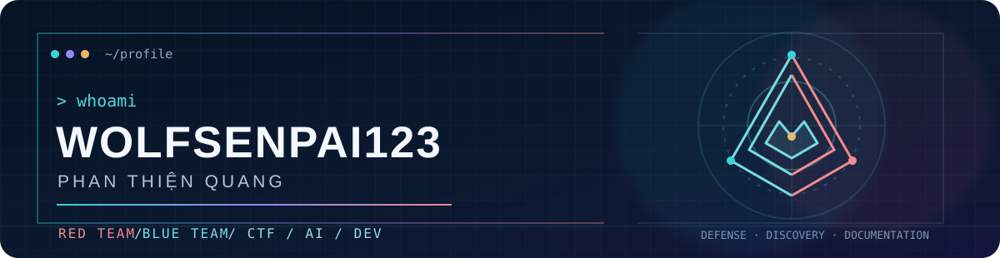

<div align="center">

  

  <a href="https://github.com/Wolfsenpai123">
    
  </a>

  <p>
    
    
    
  </p>

</div>

---

### `wolfsenpai@linux:~$ cat about_me.txt`

```yaml
name: Phan Thiện Quang
handle: Wolfsenpai123
education: FPT University 🎓
roles:
  - "Cybersecurity Enthusiast & CTF Player 🚩"
  - "Software & Database Developer 💻"
  - "Active Member @ SiTi Group 🎨🤝"
focus:
  red_team: [CTF, reconnaissance, authorized security labs]
  blue_team: [forensics, threat detection, privacy tooling]
  building: [Python tools, web apps, AI experiments]
interests:
  security: [Cryptography, Network Forensics, Reverse Engineering, Web/Binary Exploitation, Security GRC]
  ops_and_dev: [Linux CLI, Backend Scripting, Relational Databases, "SRE & Cloud Fundamentals"]
  creative: [UI/Visual Design, Pixel Art, "Community & Charity Projects"]
current_status: "Hunting flags, automating workflows with Python, and building meaningful projects."
```

I enjoy both sides of security: understanding how systems break, then building ways to detect and protect them. The projects below are the work behind that description.

### ⚔️ Red + Blue in practice

| Focus | Project | What is in the repo |
| :--- | :--- | :--- |
| 🔴 Red Team | [External pentest report](https://github.com/Wolfsenpai123/mediroza_external_pentest_report) | A published training assessment report covering scope, methodology, findings, and evidence handling. |
| 🔴 Red Team | [Footprinting & network scanning](https://github.com/Wolfsenpai123/Cybersecurity-Footprinting-Network-Scanning) | Reconnaissance, OSINT, web fingerprinting, and local network discovery lab notes. |
| 🔵 Blue Team + AI | [Ransomware AI Detection](https://github.com/Wolfsenpai123/Ransomware_AI_Dectection) | An academic prototype using simulated behavior logs for detection and SOC-style response. |
| 🔵 Blue Team | [MetaShield](https://github.com/Wolfsenpai123/metashield) | A metadata risk scanner and sanitizer for JPEG, PNG, PDF, and DOCX files. |
| 🚩 CTF | [CSCV 2026 write-ups](https://github.com/Wolfsenpai123/CSCV2026-Writeup) | Forensics walkthroughs and reproducible solver scripts. |
| 💻 Development | [SecureAuth Web](https://github.com/Wolfsenpai123/Secure-Login-System-Web) | A Flask and SQLite authentication learning project using Argon2 password hashing. |

More from the lab: [Grand Larceny Auto reverse engineering write-ups](https://github.com/Wolfsenpai123/Grand-Larceny-Auto-Writeups) · [File Integrity Checker](https://github.com/Wolfsenpai123/File-Integrity-Checker-hash-comparison-) · [simple iptables firewall](https://github.com/Wolfsenpai123/simple-iptables-firewall).

### 🛠️ Tech stack & security toolkit

#### 💻 Languages, databases & DevOps

<p align="center">
  
</p>

#### 🛡️ Cybersecurity, networking & domains

- **Offense:** `OSINT` · `Burp Suite` · `Nmap` · `CTF`
- **Defense:** `Forensics` · `SHA-256` · `iptables` · `Metadata analysis`
- **AI & monitoring:** `XGBoost` · `Isolation Forest` · `Prometheus` · `Grafana`

### 📊 GitHub telemetry

<p align="center">
  
  
</p>

### 🌐 Connect with me

<p align="center">
  <a href="https://github.com/Wolfsenpai123">GitHub profile</a> · <a href="https://github.com/Wolfsenpai123?tab=repositories">Explore all repositories</a>
  <br />
  <sub>“Talk is cheap. Show me the packet capture &amp; the source code.” 🐺⚡</sub>
</p>
